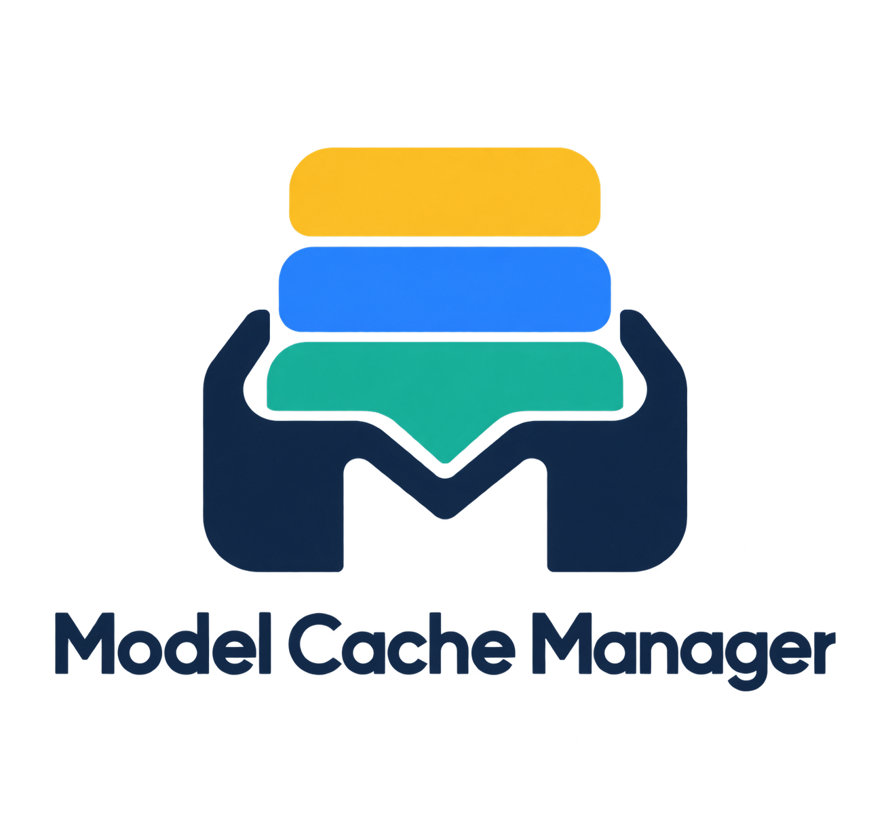
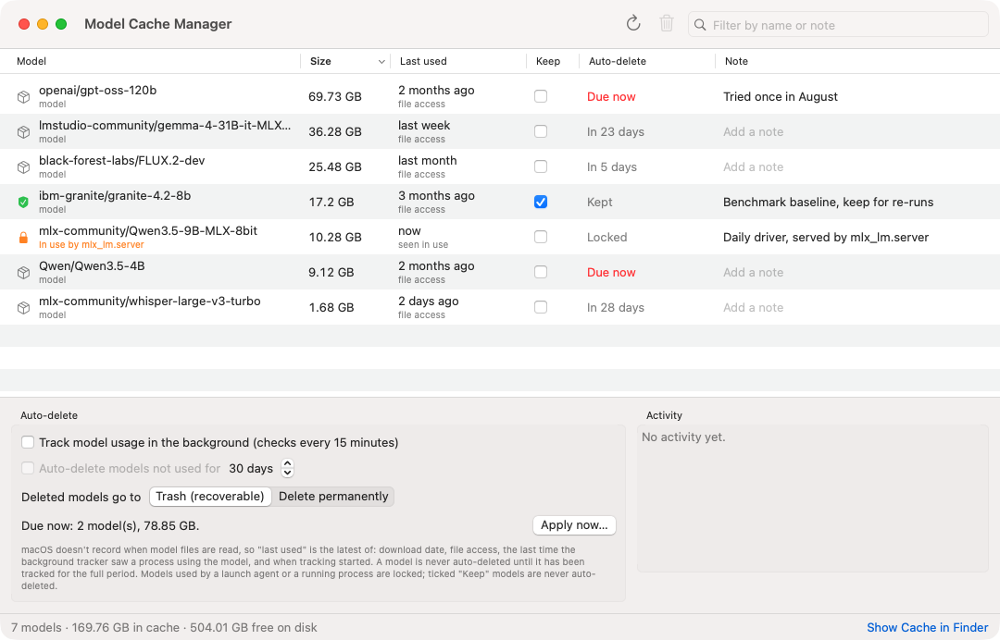
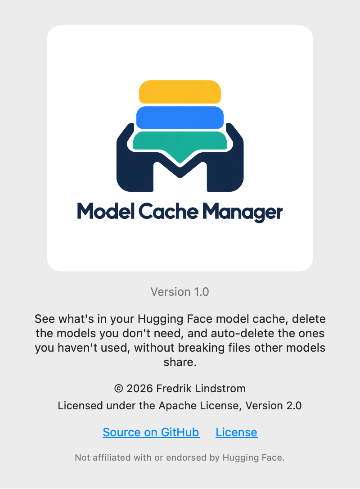

<p align="center"></p>

# Model Cache Manager

A small native macOS app for the Hugging Face model cache and Ollama's model store. See what's taking up space, delete the models you don't need, and optionally auto-delete the ones you haven't used for a while, without breaking files that other models share.

Works with anything that downloads through `huggingface_hub`: MLX (`mlx-lm`, `mlx-vlm`), Transformers, Diffusers, and the `hf` CLI. Models pulled with Ollama show up in the same list.



## Features

- **Every cached model in one table**: size, last-used evidence, and status. Sort by size or last use, and filter by name or note.
- **Delete by selection**: click (or ⇧/⌘-click) the models you want gone. By default they go to the Trash as one item per model, so a mistake is recoverable. Permanent delete is an option.
- **Shared-file safe**: the cache keeps weights in a shared, content-addressed `blobs/` store, and model folders only hold links into it. Deleting a model removes the folder *and* the blobs only that model uses. Blobs another model still needs are never touched. The size shown is what deleting actually frees.
- **Ollama too**: every Ollama `model:tag` is a row (marked with an *Ollama* badge, listed as e.g. `ollama/library/qwen3:8b`). Ollama shares layers between tags the same way, so sizes and deletes follow the same shared-blob rules. Keep, notes and projects work exactly as for Hugging Face models. Auto-delete leaves Ollama models alone unless you also switch on *Include Ollama models*: a model you built with `ollama create` looks just like a pulled one, and may not be downloadable again.
- **Projects**: group models by what they're for ("Local Video Generation", "Speech", "Benchmarks"). Drag rows onto a project in the sidebar, or right-click → Add to Project. A model can be in several projects, and a whole project can be kept out of auto-delete with one switch. Deleting a project only removes the grouping, never the models.
- **Keep**: tick it to exclude a single model from auto-delete.
- **Notes**: a free-text comment per model ("used by my nightly job", "benchmark only, delete after Friday").
- **Auto-delete**: remove models not used for *N* days (default 30), checked by a lightweight background agent.
- **Locks**: a model is never deleted, by hand or automatically, while a running process names it, holds its files open, or a launch agent or daemon on your Mac refers to it. An Ollama model is also locked while the Ollama server has it loaded (`ollama ps`); `ollama stop <name>` unloads it. If the server's answer can't be read, the Ollama models are locked until it can (Hugging Face models are unaffected).

## How "last used" works, and why it's careful

macOS doesn't update a file's access time when model weights are read. A model server can load a model every day while the file still shows the date it was downloaded. So a naive "not accessed for 30 days" rule, including the one `hf cache ls` reports, can delete models you use daily.

Model Cache Manager uses the latest of:

1. the download date and any recorded file access,
2. the last time its background agent saw a process using the model (named in the process's arguments, e.g. `mlx_lm.server --model org/name`, or holding its files open).

On top of that:

- **Grace period:** the auto-delete clock never starts earlier than when the app began tracking a model. Nothing is auto-deleted until it has been observed for the full period.
- **Launch agent references:** models named in a LaunchAgent or LaunchDaemon plist are locked, so a server that's stopped right now still keeps its model.

## Safety

Deleting is the one thing this app must never get wrong, so:

- **Nothing outside the cache.** It only removes real model folders directly inside the cache, and blobs that are real files in the cache's `blobs/` store. A "model folder" that is a symbolic link is never listed or deleted, and everything is re-checked right before it's moved.
- **All-or-nothing Trash moves.** If any step fails, everything already moved is put back. An interrupted delete is reported in the window and by `--list`, not left hidden.
- **Fresh decisions.** Deleting re-scans first, and nothing is deleted if the in-use check (`ps`/`lsof`) failed.
- **Ollama models are deleted as files, never through the server.** A running Ollama server may be using a different store that holds an identical copy of the same model, and nothing it reports can prove otherwise. So the app removes the manifest and the blobs no other manifest uses itself. To the Trash, that is one item laid out like the store (`manifests/…` and `blobs/`). To restore it, merge those two folders back into the store with `ditto "<Trash item>" ~/.ollama/models` (or Option-drag in Finder and choose **Merge**). Don't drag them in and choose *Replace*: that would replace the store's whole `manifests` or `blobs` folder and lose every other model. Every manifest is re-read right before deleting, a blob named by anything else (another tag, a file it can't parse, a Hugging Face link) is never touched, and nothing is removed while an Ollama download is in progress. If any part of the store can't be read, no Ollama model is deleted, because a missed reference would make a shared layer look unused. A model whose own layers can't be removed with it (a linked or relocated `blobs` folder) is refused rather than half-deleted. The same caution applies across the two stores: if part of the Hugging Face cache can't be read, Ollama models and any Hugging Face model with files outside its own folder stay put until it can.
- **No redirection.** Every folder on the way to a file is opened without following symbolic links and held open while the file is removed or moved, so swapping a folder for a link mid-delete can't send it outside the cache or the store. A permanent delete first moves the model folder into a hidden staging folder (`.mcc-staging-…` in the cache folder), then removes it one entry at a time through those open folders; a link found inside is removed as a link. Before anything goes to the Trash (which only takes a path), the app checks the path still leads to the exact folders it holds open.
- **Talking to Ollama.** The app only asks the local server what it has loaded (`/api/ps`), on `127.0.0.1` (or `[::1]` if `OLLAMA_HOST` says so), never through a proxy, never following a redirect, and stops reading after 1 MB or a couple of seconds.
- **Conservative auto-delete.** It stands down after a long gap or a clock jump (and restarts the observation period), and it won't delete more than 25 models in one unattended run.

## Install

Requires macOS 14 or later and Xcode (or the Swift toolchain) to build:

```bash
git clone https://github.com/fredriklindstrom/model-cache-manager.git
cd model-cache-manager
./build.sh --install        # builds and copies "Model Cache Manager.app" to ~/Applications
```

The build is signed ad hoc, not notarized. If macOS blocks it the first time, right-click the app and choose **Open**.

## Background tracking and auto-delete

Both are **off** until you switch them on in the app:

- **Track model usage in the background** installs a per-user launch agent (`~/Library/LaunchAgents/io.github.fredriklindstrom.modelcachemanager.agent.plist`). It runs every 15 minutes at background priority, records which models are in use, and applies the auto-delete rule once a day when enabled.
- **Auto-delete** uses the rule above. **Apply now…** shows exactly what would be deleted before doing anything.

Switching tracking off removes the launch agent. Settings, notes and the activity log live in `~/Library/Application Support/ModelCacheManager/`.

## Cache location

Honours `HF_HUB_CACHE`, then `HF_HOME/hub`, then the default `~/.cache/huggingface/hub`.

For Ollama: `OLLAMA_MODELS`, then the default `~/.ollama/models`. If you moved Ollama's store, launch the app from a shell that has `OLLAMA_MODELS` set (or set it with `launchctl setenv`, as Ollama's docs describe); the background agent remembers the location it was switched on with. A non-default port in `OLLAMA_HOST` (and `[::1]`) is honoured, and the background agent remembers it too, but the app only ever talks to the server on this Mac. A server bound only to a LAN address can't be asked what it has loaded; its runner processes and open model files are still caught by the `ps`/`lsof` checks.

Ollama unloads an idle model after 5 minutes by default and the background agent checks every 15, so a model you only use for a moment can go unseen. Tick *Keep* on anything you rely on.

## Command line

The app binary has a few headless modes:

```bash
APP="$HOME/Applications/Model Cache Manager.app/Contents/MacOS/ModelCacheManager"
"$APP" --list                          # scan and print every model with size, last use and locks
"$APP" --list --json                   # the same as JSON, for scripts
"$APP" --delete model/org/name         # delete one model to the Trash (add --permanent to skip it)
"$APP" --delete ollama/library/qwen3:8b   # an Ollama model, by the id --list prints
"$APP" --agent                         # run one tracking / auto-delete tick
```

`--list` ends with a total line; when an Ollama store exists it splits the two stores, e.g. `26 HF repos, 303.85 GB; 1 Ollama model, 17 GB on disk`.

`--list --json` prints one object: `models`, an array sorted by size, and `totals`.

```json
{
  "models": [
    {
      "id": "ollama/library/qwen3:8b", "store": "ollama", "name": "qwen3:8b",
      "path": "/Users/you/.ollama/models/manifests/registry.ollama.ai/library/qwen3/8b",
      "exclusive_bytes": 5225374524, "total_bytes": 5225376000,
      "last_used": "2026-10-11T09:00:00Z", "last_used_source": "seen in use",
      "locked": true, "lock_reason": "Loaded in Ollama",
      "keep": false, "project_kept": false, "projects": ["Benchmarks"], "note": ""
    }
  ],
  "totals": {
    "hf": { "models": 26, "bytes": 303850000000, "root": "/Users/you/.cache/huggingface/hub" },
    "ollama": { "models": 1, "bytes": 5225376000, "root": "/Users/you/.ollama/models", "present": true },
    "usage_reliable": true
  }
}
```

`store` is `hf` or `ollama`. `totals.ollama.complete` is `false`, with an `incomplete_reason`, when part of the Ollama store couldn't be read; Ollama deletes are refused until it can. `exclusive_bytes` is what deleting frees; `total_bytes` includes files shared with other models. `last_used` and `lock_reason` are `null` when there's nothing to report. `--delete` refuses to run when `usage_reliable` would be false.

## Rebuilding the icon

`swift scripts/make_icon.swift` crops the mark from `Assets/logo.png` into `Assets/AppIcon-1024.png`. `build.sh` packages the `.icns`.

<p align="center"></p>

## License

Apache License 2.0. See [LICENSE](LICENSE) and [NOTICE](NOTICE).
© 2026 Fredrik Lindstrom.

Not affiliated with or endorsed by Hugging Face or Ollama.
