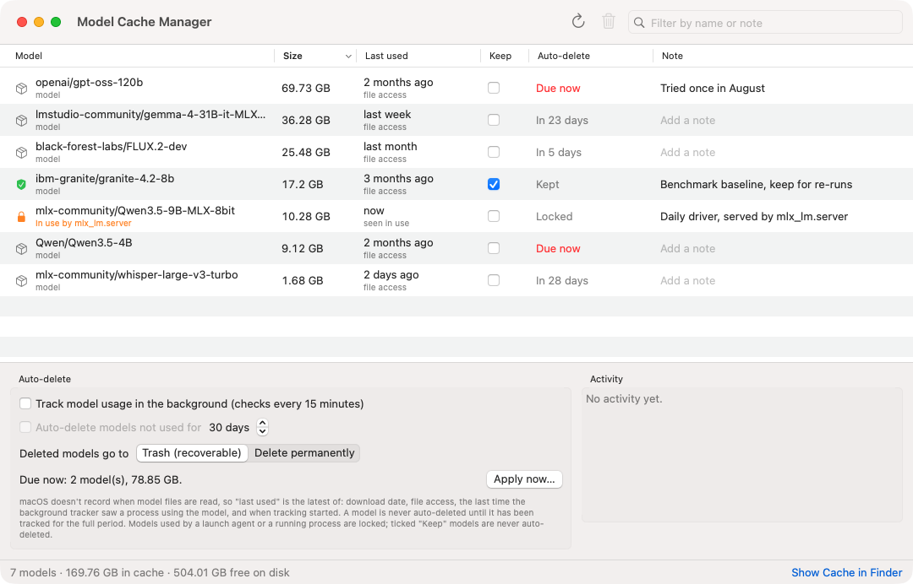
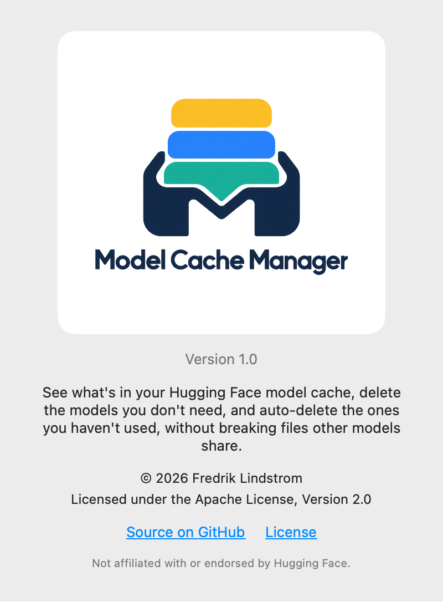

<p align="center"></p>

# Model Cache Manager

A small native macOS app for the Hugging Face model cache and Ollama's model store. See what's taking up space, delete the models you don't need, and optionally auto-delete the ones you haven't used for a while, without breaking files that other models share.

Works with anything that downloads through `huggingface_hub`: MLX (`mlx-lm`, `mlx-vlm`), Transformers, Diffusers, and the `hf` CLI. Models pulled with Ollama show up in the same list.



## Features

- **Every cached model in one table**: size, last-used evidence, and status. Sort by size or last use, and filter by name or note.
- **Delete by selection**: click (or ⇧/⌘-click) the models you want gone. By default they go to the Trash as one item per model, so a mistake is recoverable. Permanent delete is an option.
- **Shared-file safe**: the cache keeps weights in a shared, content-addressed `blobs/` store, and model folders only hold links into it. Deleting a model removes the folder *and* the blobs only that model uses. Blobs another model still needs are never touched. The size shown is what deleting actually frees.
- **Ollama too**: every Ollama `model:tag` is a row (marked with an *Ollama* badge, listed as e.g. `ollama/library/qwen3:8b`). Ollama shares layers between tags the same way, so sizes and deletes follow the same shared-blob rules. Keep, notes and projects work exactly as for Hugging Face models. Ollama 0.40's newer `manifests-v2/` layout is read too (a tag there is a link to a manifest blob, sometimes a list of per-runner variants), and a model in both layouts is one row. The app doesn't delete from `manifests-v2/` yet: a model that has a tag there says so and points you to `ollama rm`, and every blob a v2 manifest uses counts as used, so deleting another model never takes a layer it needs. Manifest files' own dates are never counted as use (the app reads them on every scan); a model's dates come from its layers. Auto-delete leaves Ollama models alone unless you also switch on *Include Ollama models*: a model you built with `ollama create` looks just like a pulled one, and may not be downloadable again.
- **Projects**: group models by what they're for ("Local Video Generation", "Speech", "Benchmarks"). Drag rows onto a project in the sidebar, or right-click → Add to Project. A model can be in several projects, and a whole project can be kept out of auto-delete with one switch. Deleting a project only removes the grouping, never the models.
- **Keep**: tick it to exclude a single model from auto-delete.
- **Notes**: a free-text comment per model ("used by my nightly job", "benchmark only, delete after Friday").
- **Auto-delete**: remove models not used for *N* days (default 30), checked by a lightweight background agent.
- **Model folders**: models that live outside both stores (benchmark downloads, `hf download --local-dir`, loose GGUF files) can be listed too. Add a folder with **Model Folders › Add Folder…** in the footer (or `--add-folder PATH`). An entry directly inside it becomes a row (with a *Folder* badge) only when it is clearly a model: a folder whose weights files (`.gguf`, `.safetensors`, `.bin`, `.pt`, … within three levels) add up to at least 20 MB and to most of its bytes, or a weights file of at least 20 MB. Parts of a split GGUF (`name-00001-of-00003.gguf`) are one row, and an incomplete set can't be deleted. A folder holding a git checkout, an app bundle or `node_modules` is never a model, and nothing else in the watched folder is listed. Folders are walked through held, no-follow handles, links are never followed or deleted through, and every link under a watched folder that points into the Hugging Face cache, Ollama's store or another watched folder keeps the model it points into from being deleted, so nothing can break a folder model behind its back. A hard-linked file frees nothing and isn't counted. A watched folder may not be `/`, your home folder or anything above it, a system folder (`/System`, `/Library`, `/Applications`, `~/Library`, …), inside or above either store, or inside or above another watched folder; these checks compare the folders themselves, not their paths, so an alias path can't get round them. Auto-delete leaves these models alone unless you also switch on *Include models in watched folders*, and a watched drive that was unplugged starts a fresh observation period when it comes back. Stopping watching a folder deletes nothing. One limit: only links *under* watched folders are seen. A link somewhere else on your Mac that points into a watched-folder model doesn't stop that model being deleted (the same is true of links into the Hugging Face cache from outside it).
- **Locks**: a model is never deleted, by hand or automatically, while a running process names it, holds its files open, or a launch agent or daemon on your Mac refers to it. This works for any file name: the checks run `ps` and `lsof` in a UTF-8 locale and read launch-agent plists' own strings (before 1.3, a path with non-ASCII characters such as `Modèles` was missed). A name `lsof` still can't print locks the models it might belong to. A process working inside a watched folder that names a model by a relative path (`--model qwen3-8b`) counts too. An Ollama model is also locked while the Ollama server has it loaded (`ollama ps`); `ollama stop <name>` unloads it. If the server's answer can't be read, the Ollama models are locked until it can (Hugging Face models are unaffected).

## How "last used" works, and why it's careful

macOS doesn't update a file's access time when model weights are read. A model server can load a model every day while the file still shows the date it was downloaded. So a naive "not accessed for 30 days" rule, including the one `hf cache ls` reports, can delete models you use daily.

Model Cache Manager uses the latest of:

1. the download date and any recorded file access,
2. the last time its background agent saw a process using the model (named in the process's arguments, e.g. `mlx_lm.server --model org/name`, or holding its files open).

On top of that:

- **Grace period:** the auto-delete clock never starts earlier than when the app began tracking a model. Nothing is auto-deleted until it has been observed for the full period.
- **Launch agent references:** models named in a LaunchAgent or LaunchDaemon plist are locked, so a server that's stopped right now still keeps its model.

## Safety

Deleting is the one thing this app must never get wrong, so:

- **Nothing outside the cache.** It only removes real model folders directly inside the cache, and blobs that are real files in the cache's `blobs/` store. A "model folder" that is a symbolic link is never listed or deleted, and everything is re-checked right before it's moved.
- **All-or-nothing Trash moves.** If any step fails, everything already moved is put back. An interrupted delete is reported in the window and by `--list`, not left hidden.
- **Fresh decisions.** Deleting re-scans first, and nothing is deleted if the in-use check (`ps`/`lsof`) failed.
- **Ollama models are deleted as files, never through the server.** A running Ollama server may be using a different store that holds an identical copy of the same model, and nothing it reports can prove otherwise. So the app removes the manifest and the blobs no other manifest uses itself (from `manifests/` only; see *Ollama too* for `manifests-v2/`). To the Trash, that is one item laid out like the store (`manifests/…` and `blobs/`). To restore it, merge those two folders back into the store with `ditto "<Trash item>" ~/.ollama/models` (or Option-drag in Finder and choose **Merge**). Don't drag them in and choose *Replace*: that would replace the store's whole `manifests` or `blobs` folder and lose every other model. Every manifest is re-read right before deleting, a blob named by anything else (another tag, a file it can't parse, a Hugging Face link) is never touched, and nothing is removed while an Ollama download is in progress. If any part of the store can't be read, no Ollama model is deleted, because a missed reference would make a shared layer look unused. A model whose own layers can't be removed with it (a linked or relocated `blobs` folder) is refused rather than half-deleted. The same caution applies across the two stores: if part of the Hugging Face cache can't be read, Ollama models and any Hugging Face model with files outside its own folder stay put until it can.
- **No redirection.** Every folder on the way to a file is opened without following symbolic links and held open while the file is removed or moved, so swapping a folder for a link mid-delete can't send it outside the cache or the store. A permanent delete first moves the model folder into a hidden staging folder (`.mcc-staging-…` in the cache folder), then removes it one entry at a time through those open folders; a link found inside is removed as a link. Before anything goes to the Trash (which only takes a path), the app checks the path still leads to the exact folders it holds open.
- **Talking to Ollama.** The app only asks the local server what it has loaded (`/api/ps`), on `127.0.0.1` (or `[::1]` if `OLLAMA_HOST` says so), never through a proxy, never following a redirect, and stops reading after 1 MB or a couple of seconds.
- **Conservative auto-delete.** It stands down after a long gap or a clock jump (and restarts the observation period), and it won't delete more than 25 models in one unattended run.

## Install

Requires macOS 14 or later and Xcode (or the Swift toolchain) to build:

```bash
git clone https://github.com/fredriklindstrom/model-cache-manager.git
cd model-cache-manager
./build.sh --install        # builds and copies "Model Cache Manager.app" to ~/Applications
```

The build is signed ad hoc, not notarized. If macOS blocks it the first time, right-click the app and choose **Open**.

## Background tracking and auto-delete

Both are **off** until you switch them on in the app:

- **Track model usage in the background** installs a per-user launch agent (`~/Library/LaunchAgents/io.github.fredriklindstrom.modelcachemanager.agent.plist`). It runs every 15 minutes at background priority, records which models are in use, and applies the auto-delete rule once a day when enabled.
- **Auto-delete** uses the rule above. **Apply now…** shows exactly what would be deleted before doing anything.

Switching tracking off removes the launch agent. Settings, notes and the activity log live in `~/Library/Application Support/ModelCacheManager/`.

## Cache location

Honours `HF_HUB_CACHE`, then `HF_HOME/hub`, then the default `~/.cache/huggingface/hub`.

For Ollama: `OLLAMA_MODELS`, then the default `~/.ollama/models`. If you moved Ollama's store, launch the app from a shell that has `OLLAMA_MODELS` set (or set it with `launchctl setenv`, as Ollama's docs describe); the background agent remembers the location it was switched on with. A non-default port in `OLLAMA_HOST` (and `[::1]`) is honoured, and the background agent remembers it too, but the app only ever talks to the server on this Mac. A server bound only to a LAN address can't be asked what it has loaded; its runner processes and open model files are still caught by the `ps`/`lsof` checks.

Ollama unloads an idle model after 5 minutes by default and the background agent checks every 15, so a model you only use for a moment can go unseen. Tick *Keep* on anything you rely on.

## Command line

The app binary has a few headless modes:

```bash
APP="$HOME/Applications/Model Cache Manager.app/Contents/MacOS/ModelCacheManager"
"$APP" --list                          # scan and print every model with size, last use and locks
"$APP" --list --json                   # the same as JSON, for scripts
"$APP" --delete model/org/name         # delete one model to the Trash (add --permanent to skip it)
"$APP" --delete ollama/library/qwen3:8b   # an Ollama model, by the id --list prints
"$APP" --agent                         # run one tracking / auto-delete tick
```

`--list` ends with a total line; when an Ollama store exists it splits the two stores, e.g. `26 HF repos, 303.85 GB; 1 Ollama model, 17 GB on disk`.

`--list --json` prints one object: `models`, an array sorted by size, and `totals`.

```json
{
  "models": [
    {
      "id": "ollama/library/qwen3:8b", "store": "ollama", "name": "qwen3:8b",
      "path": "/Users/you/.ollama/models/manifests/registry.ollama.ai/library/qwen3/8b",
      "exclusive_bytes": 5225374524, "total_bytes": 5225376000,
      "last_used": "2026-10-11T09:00:00Z", "last_used_source": "seen in use",
      "locked": true, "lock_reason": "Loaded in Ollama",
      "keep": false, "project_kept": false, "projects": ["Benchmarks"], "note": ""
    }
  ],
  "totals": {
    "hf": { "models": 26, "bytes": 303850000000, "root": "/Users/you/.cache/huggingface/hub" },
    "ollama": { "models": 1, "bytes": 5225376000, "root": "/Users/you/.ollama/models", "present": true },
    "usage_reliable": true
  }
}
```

`store` is `hf` or `ollama`. `totals.ollama.complete` is `false`, with an `incomplete_reason`, when part of the Ollama store couldn't be read; Ollama deletes are refused until it can. `exclusive_bytes` is what deleting frees; `total_bytes` includes files shared with other models. `last_used` and `lock_reason` are `null` when there's nothing to report. `--delete` refuses to run when `usage_reliable` would be false.


Watched model folders:

```bash
"$HOME/Applications/Model Cache Manager.app/Contents/MacOS/ModelCacheManager" --add-folder ~/benchmarks/models
"$HOME/Applications/Model Cache Manager.app/Contents/MacOS/ModelCacheManager" --remove-folder ~/benchmarks/models   # deletes nothing
```

Folder models appear in `--list` with ids `folder:<absolute path>` (store `folder`) and can be deleted with `--delete` like any other.

## llmavail: which models are here, and ready to run

`llmavail` answers "is this model on my Mac, complete, and runnable?" in one call, for you or for a script or coding agent deciding whether something needs downloading. It is the same binary under another name, and it is **strictly read-only**: it never deletes, downloads, moves or writes anything (not even the app's state file), and it uses the network only with `--access`.

`./build.sh --install` links it as `~/.local/bin/llmavail` (put `~/.local/bin` on your `PATH`). Without the link, `"$APP" llmavail …` does the same.

```bash
llmavail                       # every model in every store
llmavail qwen                  # names containing "qwen" (several terms must all match)
llmavail --format gguf         # safetensors, mlx, gguf, ollama, pytorch, onnx, none
llmavail --source ollama       # hf, ollama, lmstudio, folder
llmavail --incomplete          # only models with something missing (or --complete)
llmavail --path ~/bench/models # also models in this folder, for this run only
llmavail --access              # Hugging Face: gated or not, and whether your login has access
llmavail qwen --verify         # hash every file against the hash it was downloaded under
llmavail qwen --verify --access   # … and check those against the Hub's list for the cached revision
llmavail --json                # machine-readable
```

```
SOURCE  MODEL                                    REV      FORMAT  QUANT   SIZE      STATUS      LAST USED   KEEP  NOTE
hf      lmstudio-community/Qwen3.8-27B-MLX-8bit  241ebb5  mlx     8bit    29.53 GB  complete    in use      keep
hf      pipenetwork/MiniMax-H3-MLX-8bit          e55f97c  none    -       40 bytes  INCOMPLETE  never       keep
    ! no snapshot: only refs are cached, no files
ollama  qwen3.8:27b                              e118e4d  ollama  nvfp4   18.17 GB  complete    2026-11-14  -
```

Exit status: 0 when at least one model is listed, 1 when nothing matched, 2 for bad arguments.

**Where it looks**: the Hugging Face cache (`HF_HUB_CACHE`, else `HF_HOME/hub`, else `~/.cache/huggingface/hub`), Ollama's store (`OLLAMA_MODELS`, else `~/.ollama/models`; both the `manifests/` layout and the newer `manifests-v2/` one, where a tag is a link to a manifest blob and may be a list of per-runner variants), LM Studio (`LMSTUDIO_MODELS`, else `~/.lmstudio/models` and `~/.cache/lm-studio/models`, as `<publisher>/<model>/`), and the app's watched model folders plus any `--path`.

**Size** is what the model's files take on disk with every link followed to the real data. This matters: the Hugging Face cache can keep weights in one shared, content-addressed `blobs/` store with each model folder holding only links into it, so `du` on a model folder shows a few MB for a 30 GB model. Files shared between models count in each of them.

**Complete** means every weights file is there and whole:
- every shard a `*.safetensors.index.json` or `*.bin.index.json` names is present (diffusers sub-folders' own indexes too);
- numbered parts without an index (`x-00001-of-00003.gguf`) are all present;
- no link points at a file that isn't on disk, and no download is unfinished (`.incomplete` files);
- each safetensors and GGUF file is as long as its header says: safetensors from the tensors' `data_offsets`, GGUF from its tensor table (each tensor's shape, ggml type and offset, plus the alignment). That catches a truncated or half-copied file without reading the weights. A GGUF whose last tensor has a type this doesn't know (a format newer than the code) is unverified rather than complete;
- diffusers pipelines: every component `model_index.json` names has its folder, and a model component (one with a `config.json`) has weights;
- Hugging Face: the snapshot `refs/main` names exists (a repo with refs but no snapshot is listed as incomplete);
- Ollama: every layer of the manifest is in `blobs/` at full size; for a manifest list, at least one variant is whole (`variants` in the JSON says which).

**It never changes a model file's access time.** On APFS, reading a file whose access time is older than its modification time sets the access time to now, and the app counts model files' access times as evidence of use. So `llmavail` checks each model file with `stat` before opening it and leaves any such file unopened (opening can be enough on a Mac with an on-access malware scanner). That keeps it from making a model look used today and holding off auto-delete. Folder access times and the bookkeeping files it reads (`refs/main`, Ollama manifests, the app's `state.json`, launch-agent plists, the token file) aren't evidence of use and may change. Each skipped check is listed (`?` lines; `unchecked` in the JSON). If the skipped file was needed to decide, the model is **unverified**, neither complete nor incomplete. That covers a weights file whose header wasn't checked (a file that has never been read is the likeliest to be truncated), an index, a `model_index.json`, and an unfinished `.incomplete` download in the repo (it may belong to another revision). In the JSON that's `"status": "unverified"` with `"complete": null`, and neither `--complete` nor `--incomplete` lists it. The size check on files, the numbered-part check and the link check need no reads and always run. Ollama manifests (files and manifest blobs) are read freely: they are bookkeeping, and the app never counts their dates as use. Ollama layers are never read except the small config layer, which is checked like any other file.

Limits: files more than six folders deep aren't seen, and without `--verify` nothing is hashed, so `complete` means "all there and the right length", not "the bytes the Hub has".

**`--verify`** reads every byte of the listed models and checks each file against the hash it was downloaded under. In the Hugging Face cache a snapshot file links to `blobs/<name>`, and that name is the hash the Hub gave at download: the SHA-256 for large (LFS) files, the git blob SHA-1 for small ones. Ollama names every layer, config and manifest blob `sha256-<hash of its content>`. LM Studio and plain folders keep no hashes, so their models say `no reference hash`. A file that doesn't match makes the model incomplete (`content doesn't match the hash it was downloaded under`). The same access-time rule applies: a file a read would touch is skipped and the model is `partly verified`. Each file is hashed once even when several models share it, three at a time, without filling the page cache (`F_NOCACHE`, so loaded models stay in memory); expect several minutes per 100 GB. Filter first (`llmavail qwen --verify`). Progress goes to stderr when it's a terminal. With `--access` as well, it also fetches the Hub's file list for the cached revision (one request per repo, without the token unless the repo needs it) and checks that each cached file's size and recorded hash are the ones the Hub lists. That ties the bytes on disk to the Hub, not only to the name they were saved under. A file the Hub's list doesn't have is noted (`?`).

**Format and quant** come from the files and `config.json`: `gguf` if there are GGUF files, `mlx` for safetensors with an MLX `quantization` block, an MLX name or `.npz` weights, else `safetensors`. Quant is bits per weight from the name (`3.3bpw`), then the config (`8bit`, `mxfp4`, `gptq-4bit`), then the name (`Q8`, `bf16`), then the config's dtype (`bf16`). GGUF quant comes from the file names (`Q4_K_M`), Ollama's from the model's config layer (`file_type`).

**Last used, in use, Keep and note** are the app's own: the same evidence as the window (file dates, plus the last time the background agent saw a process using it) and the same `ps` / `lsof` / launch-agent checks for "in use" (`--no-usage` skips those). It does not ask the Ollama server anything.

**`--access`** uses your existing Hugging Face login, the token `hf auth login` saved (`HF_TOKEN`, else the file at `HF_TOKEN_PATH`, else `$HF_HOME/token`, else `~/.cache/huggingface/token`). For each Hugging Face row it asks the Hub's model API whether the repo is gated (without the token, unless the repo is only visible with it), and for a gated one sends a `HEAD` with the token for one small file of the cached revision. That does tell the Hub, under your account, which gated repos you have cached. The answers are `granted`, `pending` (request awaiting review), `rejected`, `not requested`, `no login`, `token rejected`, or `open` for a repo that isn't gated. The token is only ever sent to `https://huggingface.co` in an `Authorization` header, never in a URL; `HF_ENDPOINT` is ignored on purpose so the environment can't send it elsewhere, redirects are refused, and the token is never printed or logged. With `HF_HUB_OFFLINE` set, `--access` refuses to run. Only a plain token (letters, digits, `_`, `-`, `.`) is used.

`--json` prints `{"models": [...], "generated", "usage_reliable", "notes", "roots", "hf_login"}`. Each model has `source`, `id` (the app's id, as in `--list`), `name`, `revision`, `format`, `quant`, `size_bytes`, `size`, `status` (`complete`, `incomplete`, `unverified`), `complete` (`true`, `false`, or `null` when unverified), `problems` (why it isn't complete), `unchecked` (checks skipped to leave access times alone), `path` (the snapshot or manifest), `last_used`, `last_used_source`, `in_use`, `keep`, `project_kept`, `projects`, `note`, `snapshots`, `variants`, with `--access` `gated` (`no`, `auto`, `manual`) and `access`, and with `--verify` `verify`: `{"status": "verified" | "partly verified" | "mismatch" | "no reference hash" | "nothing to hash", "files", "matched", "mismatched", "skipped", "failed", "no_reference", "hub"}` (`hub` is `null` without `--access`, else `matches (N files)`, `differs` or `not checked (…)`). Missing values are `null`.

## Rebuilding the icon

`swift scripts/make_icon.swift` crops the mark from `Assets/logo.png` into `Assets/AppIcon-1024.png`. `build.sh` packages the `.icns`.

<p align="center"></p>

## License

Apache License 2.0. See [LICENSE](LICENSE) and [NOTICE](NOTICE).
© 2026 Fredrik Lindstrom.

Not affiliated with or endorsed by Hugging Face or Ollama.
